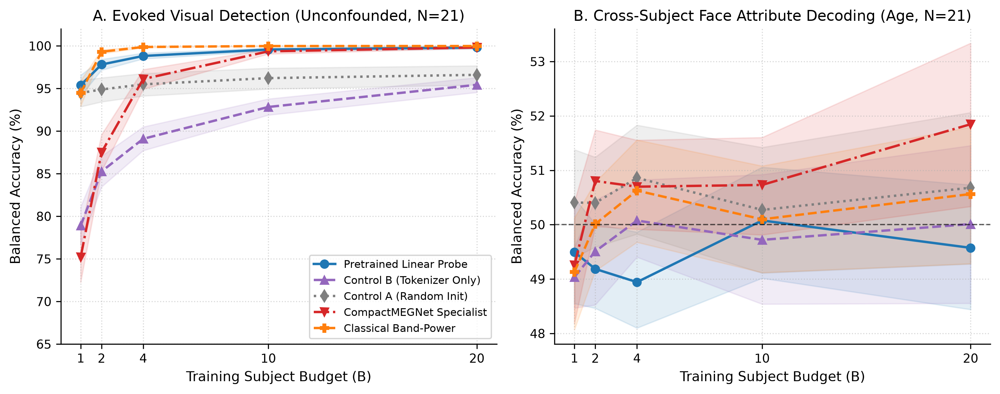
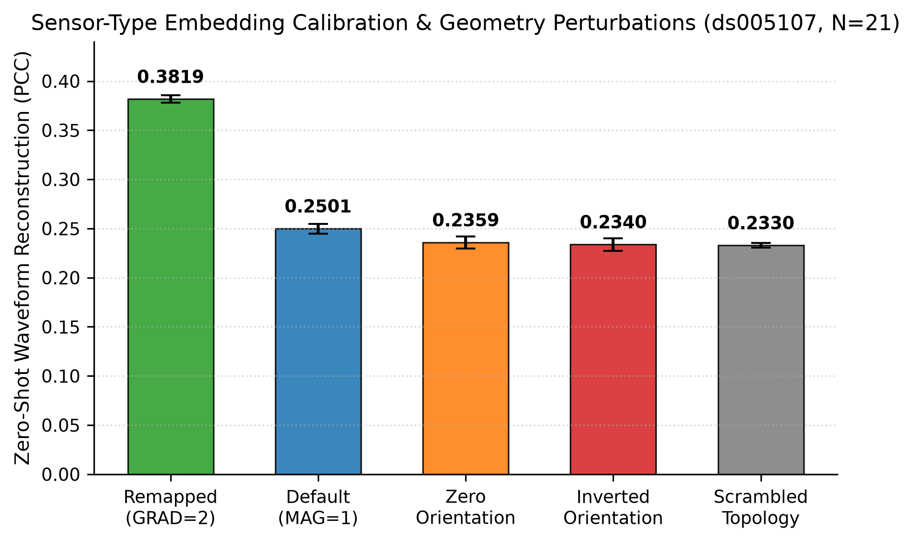
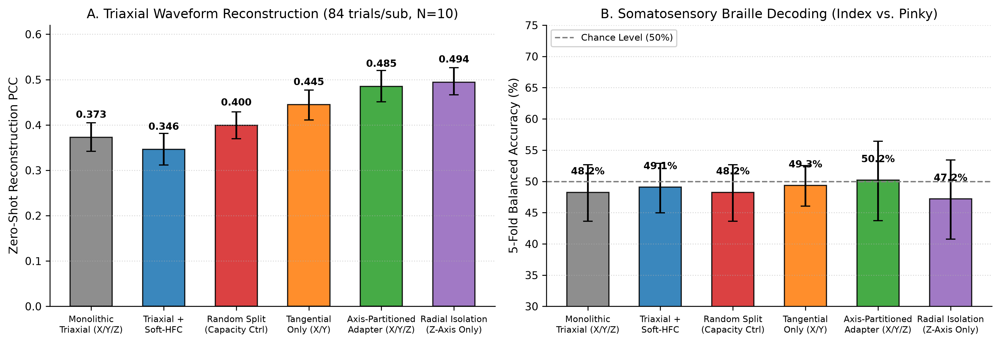

# Cross-Hardware Generalization of Electrophysiological Foundation Models: An Empirical Evaluation on Optically Pumped Magnetometers

**Target Venue:** *NeurIPS NeuroAI Workshop*

**Authors:** Samer Zumot, Marzieh Zare  
**Correspondence:** `srzumot@gmail.com`  
**Repository:** `https://github.com/samerzumot/opm-bridge`

---

## Abstract

Self-supervised electrophysiological foundation models aim to establish unified neural representations across heterogeneous recording devices and sensor montages. A prominent exemplar is BrainOmni (NeurIPS 2025), which incorporates a spatial-temporal tokenizer to process multi-channel continuous waveforms conditioned on 3D sensor coordinates, orientations, and sensor categories. However, BrainOmni was pre-trained and evaluated exclusively on conventional cryogenic superconducting quantum interference device (SQUID) arrays and electroencephalography (EEG). Emerging optically pumped magnetometers (OPMs) operate without cryogenics and conform flexibly to the scalp, introducing substantial domain shifts: close scalp proximity (~5 mm vs. 3–6 cm), localized dipolar forward topographies, non-standard channel geometries, and triaxial ($X/Y/Z$) multi-axis sensing.

In this work, we present an empirical benchmark evaluating cross-hardware generalization from SQUID-trained foundation models to on-scalp OPM-MEG recordings. Using subject-level bootstrap equivalence tests ($\text{SESOI} = \pm 3.0\%$) and matched randomly initialized controls across 21 participants (50 physically aligned helmet positions) on OpenNeuro `ds005107` and 10 adult participants with 192-channel coregistered triaxial recordings on Zenodo `11126593`, we report four primary findings:

1. **Downstream Transfer Dynamics & Data Efficiency:** On a high-SNR evoked visual detection task (contrasting pre-stimulus baseline against peak visual evoked response), pretrained representations demonstrate genuine representation transfer, scaling rapidly from 95.39% ($B=1$) to 99.81% ($B=20$) and outperforming matched randomly initialized controls (Control A: 94.47% to 96.60%; $\Delta = +3.22\%$, $p < 0.0001$). Conversely, under linear probing on low-to-medium sample budgets ($B \in \{1, 2, 4, 10, 20\}$ subjects; 256 to 5,120 trials) for single-trial face demographic tasks, all models sit at an empirical chance floor (~50%), yielding statistical equivalence to random controls ($\Delta \in [-1.92\%, +2.27\%]$).
2. **Disentangling Sequence Backbone vs. Tokenizer Inductive Priors:** Architectural ablation with `Control B` (pre-trained tokenizer coupled with an untrained, randomly initialized Transformer backbone) reveals that in decodable task regimes, the autoregressive sequence backbone contributes substantial temporal structure: Control B lags behind fully pretrained representations on visual detection ($95.43\%$ vs $99.81\%$, $\Delta = -4.38\%$, $p < 0.0001$) and in-domain SQUID face decoding ($56.10\%$ vs $61.03\%$, $\Delta = -4.93\%$). Parity between Control B and the full model occurs exclusively on low-SNR demographic tasks where all architectures collapse to chance.
3. **Sensor-Type Embedding Calibration:** BrainOmni encodes sensor categories via a discrete embedding (`EEG=0`, `MAG=1`, `GRAD=2`). Because upstream SQUID pre-training is dominated (>4:1) by axial and planar gradiometers over magnetometers, the model's cross-attention mechanisms developed strong spatial inductive priors for `GRAD=2`. Because on-scalp radial OPM magnetometers exhibit localized dipolar fields that closely approximate cryogenic gradiometers rather than distant, diffuse SQUID magnetometers, remapping radial OPM inputs from `MAG` to `GRAD` increases zero-shot waveform reconstruction Pearson correlation (PCC) by **+52.7% relative** ($0.2501 \to 0.3819$, $p < 0.0001$). An in-domain inverse control on SQUID data confirms this mechanism, yielding an identical +73.7% gain when native SQUID magnetometers are remapped to `GRAD`.
4. **Triaxial Spatial Bottlenecks & Capacity Controls:** In multi-axis QuSpin arrays where three orthogonal coils share identical 3D positions, compressing 155–176 channels through a single spatial cross-attention bottleneck ($N_{\text{neuro}} = 16$) induces marked cross-axis interference ($PCC = 0.3726 \pm 0.03$). Isolating radial channels ($Z$-axis) restores fidelity to $PCC = 0.4944 \pm 0.03$ (+32.7% relative, $\Delta = +0.1218$, $p = 0.0016$). To disentangle channel capacity from directional orthogonality, we evaluate a size-matched random 3-way partition, which only yields $PCC = 0.3995$ ($\Delta = +0.0269$). In contrast, an axis-partitioned adapter dedicated to directional components ($3 \times 16 = 48$ tokens) achieves $PCC = 0.4849 \pm 0.03$ (+30.1% relative, $\Delta = +0.1123$, $p = 0.0016$), significantly outperforming random capacity splitting ($\Delta = +0.0854$, $p = 0.0016$) and demonstrating that over 76% of the bottleneck originates from cross-axis vector interference.

---

## 1. Introduction

Magnetoencephalography (MEG) tracks macroscopic postsynaptic currents with millisecond precision and sub-centimeter source localization. However, conventional MEG systems depend on superconducting quantum interference devices (SQUIDs) operating inside liquid helium cryostats (~4 K). The rigid geometry of cryogenic dewars imposes large brain-to-sensor stand-off distances (typically 20–40 mm in adults and larger in pediatric cohorts), which dilutes magnetic field amplitude as an inverse power of distance and severely restricts participant movement.

Optically pumped magnetometers (OPMs), specifically vapor cells operating in the spin-exchange relaxation-free (SERF) regime, represent a transformative technological shift. OPMs operate at ambient scalp temperatures and mount directly onto flexible participant-specific caps, reducing stand-off distances to ~5 mm and yielding up to a four-fold gain in signal amplitude and enhanced spatial resolution. Furthermore, commercial triaxial modules (e.g., QuSpin Gen-3 QZFM) measure three mutually orthogonal magnetic field components ($B_x, B_y, B_z$) concurrently at the same scalp location.

Concurrently, the computational neuroscience and machine learning communities have invested heavily in self-supervised foundation models for electrophysiology. Architectures such as BrainOmni (NeurIPS 2025) aim to learn universal representations by tokenizing continuous multi-channel signals through a spatial-temporal encoder conditioned on 3D sensor coordinates and unit orientation vectors, followed by autoregressive sequence modeling.

Crucially, BrainOmni was developed and validated on conventional cryogenic SQUID arrays and EEG. Its training mix contained no on-scalp OPM data. Whether representations pre-trained on cryogenic dewars generalize to on-scalp OPMs—and where their structural assumptions break down—remains unquantified.

In this paper, we conduct an empirical evaluation of SQUID-to-OPM transfer learning. Rather than evaluating BrainOmni adversarially against unstated criteria, we analyze its explicit design choices, identify specific domain shifts inherent in the sensor transition, and propose lightweight architectural solutions to bridge the hardware gap.

---

## 2. Theoretical Analysis of Upstream Architectural Assumptions

BrainOmni processes continuous multichannel recordings through two primary stages:
1. **BrainTokenizer:** A temporal convolutional encoder (`SEANet`) extracts continuous 1D feature maps per channel. A spatial attention module (`BrainSensorModule`) computes query-key-value attention between $N_{\text{neuro}} = 16$ learnable latent query vectors and the sensor embeddings $\mathbf{e}_c = \text{SensorEmbed}(\mathbf{p}_c, \mathbf{u}_c, \text{type}_c)$, where $\mathbf{p}_c \in \mathbb{R}^3$ denotes position, $\mathbf{u}_c \in \mathbb{R}^3$ denotes unit orientation, and $\text{type}_c \in \{0, 1, 2\}$ denotes sensor modality. The output is quantised into discrete tokens via residual vector quantization (RVQ).
2. **Transformer Sequence Model:** An 8.4M parameter autoregressive Transformer processes discrete spatiotemporal tokens across time windows.

### 2.1 The Sensor Category Pre-Training Prior
BrainOmni's pre-training corpus comprises 2,653.8 hours of data (1,997.0 h EEG, 656.8 h MEG). We analyzed the sensor compositions across all 22 pre-training corpora (Appendix D of the upstream publication):
- CTF-275 systems (OMEGA, MEG-Narrative, AversiveMEG, THINGS-MEG): 275 radial axial first-order gradiometers per system (`type=2`).
- Elekta Neuromag-306 systems (Cam-CAN, MIND, SMN4Lang, Kymata): 204 planar gradiometers (`type=2`) and 102 magnetometers (`type=1`) per system.
- KIT / Yokogawa systems: Axial gradiometer arrays (`type=2`).

Across the entire MEG pre-training corpus, gradiometers (`GRAD`) outnumber magnetometers (`MAG`) by over 4:1. Furthermore, SQUID magnetometers possess wide baselines and pick up significant distant environmental noise, whereas gradiometers reject distant homogeneous noise and isolate nearby cortical dipoles. Consequently, BrainOmni's spatial cross-attention module learned rich, localized representations for `GRAD=2`, while the parameter subspace for `MAG=1` was optimized for noisy, lower-SNR background sensing.

When an experimenter deploys an on-scalp OPM array, standard metadata inspection indicates that OPMs measure total magnetic field ($B$), leading users to label them as magnetometers (`MAG=1`). However, because on-scalp OPMs sit directly on the scalp, their spatial lead fields are compact and localized—physically mirroring SQUID gradiometers rather than distant SQUID magnetometers.

### 2.2 Coincident Multi-Axis Sensing in Triaxial Arrays
In conventional SQUID arrays, sensors occupy distinct coordinates along a rigid dewar surface. In contrast, modern triaxial OPMs place three orthogonal photodiode channels ($B_x, B_y, B_z$) within a single sensor package sharing identical 3D spatial coordinates:
$$\mathbf{p}_{c, X} = \mathbf{p}_{c, Y} = \mathbf{p}_{c, Z}$$
$$\mathbf{u}_{c, X} \perp \mathbf{u}_{c, Y} \perp \mathbf{u}_{c, Z}$$
BrainOmni's spatial tokenizer compresses all input channels into $N_{\text{neuro}} = 16$ latent spatial queries. When 170+ triaxial channels are supplied, the cross-attention kernel receives three orthogonal vectors at each spatial point. Because the spatial query capacity is fixed at 16 tokens, cross-attention forces tangential and radial components into direct interference.

---

## 3. Materials and Methods

### 3.1 Benchmark Corpora

#### OpenNeuro ds005107 ("FACE-DEC")
- **Cohort:** 21 healthy adult human participants (`sub-01` through `sub-23`, omitting missing subjects `05` and `12`).
- **Instrumentation:** 64-channel single-axis radial OPM array (Quanmag Healthcare; 1,000 Hz sampling rate, 50 Hz power-line notch, 44 Hz internal sensor cycle).
- **Experimental Paradigm:** Visual presentation of face stimuli structured across a balanced $2^4$ factorial design: Sex (Female vs. Male), Ancestry (Asian vs. Caucasian), Age (Young vs. Older), and Expression (Neutral vs. Emotional).
- **Coordinate Framework & Harmonization:** As documented in the public BIDS repository, 3D sensor positions in the release FIF files were approximated from standard Elekta Neuromag sensor positions for 2D topomap display (`CoordinateFrame.APPROX_ELEKTA`) rather than optical millimeter-scale scalp coregistration. Bad-channel rejection removes variable outlier channels per subject. We standardized spatial inputs across all 21 participants by identifying the exact intersection of $C = 50$ helmet sensor positions present in every participant after outlier rejection.

#### Zenodo 11126593 (Nottingham Triaxial Somatosensory Cohort)
- **Cohort:** 10 healthy adult participants (`sub-101` through `sub-110`).
- **Instrumentation:** Up to 192 triaxial OPM channels (QuSpin Gen-3 zero-field magnetometers) coregistered in participant head coordinate space (`CoordinateFrame.HEAD`) using 3D optical surface scanning and digitized landmarks.
- **Experimental Paradigm:** Tactile somatosensory Braille stimulation applied to the right index finger (`Start_index`, class 0) or right little finger (`Start_pinky`, class 1).

### 3.2 Spatial Filtering: Soft Homogeneous Field Correction (Soft-HFC)
To suppress uniform external magnetic interference while maintaining numerical stability, we utilize Soft Homogeneous Field Correction (Soft-HFC):
$$\mathbf{P}_{\text{soft}}(\alpha) = \mathbf{I} - \alpha \mathbf{Q}_R \mathbf{Q}_R^T$$
where $\mathbf{Q} \in \mathbb{R}^{C \times 3}$ is the matrix of sensitive sensor orientations, and $\mathbf{Q}_R$ is an orthonormal basis derived via thin QR decomposition. Setting $\alpha = 0.25$ attenuates homogeneous external interference by 43.75% in power (25% amplitude shrinkage) while preserving full matrix rank $C$ and avoiding singular covariance matrices. Note that any neural signal component projecting onto the sensor orientation subspace $\text{col}(\mathbf{Q})$ will experience the same fractional attenuation.

### 3.3 Proposed Architectural Solutions

#### 1. Sensor-Type Embedding Calibration (`opm_as_grad`)
For radial on-scalp OPMs, we remap the categorical sensor token from magnetometer (`type=1`) to gradiometer (`type=2`), aligning input data with BrainOmni's dominant pre-training spatial prior without altering underlying numerical waveforms.

#### 2. Axis-Partitioned Tokenizer Adapter (`OPMAwareBrainOmniAdapter`)
To resolve multi-axis interference in triaxial arrays without discarding tangential data, our adapter decomposes the multichannel array into directional subsets:
$$\mathcal{S}_Z = \{c \mid \text{axis}_c = Z\}, \quad \mathcal{S}_X = \{c \mid \text{axis}_c = X\}, \quad \mathcal{S}_Y = \{c \mid \text{axis}_c = Y\}$$
Each directional bank is processed independently through `BrainTokenizer`'s spatial attention mechanism, allocating an independent $N_{\text{neuro}} = 16$ query subspace to each component. The resulting representations are reassembled into composite latent features ($3 \times 16 = 48$ spatial tokens).

### 3.4 Evaluation Protocols and Statistical Framework
- **Cross-Subject Generalization:** Evaluated via leave-one-subject-out (LOSO) cross-validation across nested subject sample budgets $B \in \{1, 2, 4, 10, 20\}$ subjects.
- **Hypothesis Testing:** Two one-sided tests (TOST) against a smallest effect size of interest ($\text{SESOI} = \pm 3.0\%$) using 10,000 subject-level bootstrap resamples. Differences are declared statistically equivalent if the 95% bootstrap confidence interval falls entirely within $[-\text{SESOI}, +\text{SESOI}]$.
- **Baseline Models:** Evaluated against `CompactMEGNet` (a parameter-efficient 1.5k parameter depthwise-separable convolutional neural network) and `ClassicalBandPowerDecoder` (Welch log power across theta, alpha, beta, and gamma bands with $L_2$-regularized logistic regression).

---

## 4. Empirical Results

### 4.1 Cross-Subject Downstream Transfer

Table 1 summarizes cross-subject decoding performance across sample budgets on `ds005107` (21 participants, 50 physically aligned helmet sensors, Soft-HFC $\alpha=0.25$):

**Table 1:** Balanced accuracy (%) and 95% bootstrap confidence intervals for cross-subject demographic decoding on `ds005107` (21 participants, 50 shared helmet channels, Soft-HFC $\alpha=0.25$, evaluated over seeds 42 and 3407).

| Task & Budget | Pre-trained Linear Probe | Control A (Random Init) | Control B (Tokenizer Only) | CompactMEGNet | Classical Baseline | Statistical Comparison |
| :--- | :--- | :--- | :--- | :--- | :--- | :--- |
| **Age ($B=1$)** | 49.50% [48.55, 50.49] | 50.41% [49.40, 51.38] | 49.04% [48.47, 49.59] | 49.25% [48.18, 50.41] | 49.13% [48.07, 50.12] | Equivalent (Δ=-0.91% [-2.29, +0.54]) |
| **Age ($B=2$)** | 49.19% [48.46, 50.01] | 50.40% [49.59, 51.24] | 49.51% [48.52, 50.45] | 50.80% [49.97, 51.74] | 50.01% [49.15, 50.78] | Equivalent (Δ=-1.21% [-2.31, -0.01]) |
| **Age ($B=4$)** | 48.94% [48.10, 49.86] | 50.86% [49.83, 51.83] | 50.08% [49.40, 50.82] | 50.70% [49.92, 51.55] | 50.63% [49.68, 51.56] | Inconclusive (Δ=-1.92% [-3.20, -0.60]) |
| **Age ($B=10$)** | 50.08% [49.02, 51.06] | 50.27% [49.11, 51.42] | 49.72% [48.54, 50.92] | 50.73% [49.81, 51.60] | 50.10% [49.12, 51.08] | Equivalent (Δ=-0.19% [-1.73, +1.40]) |
| **Age ($B=20$)** | 49.57% [48.44, 50.73] | 50.68% [49.28, 52.06] | 50.01% [48.55, 51.45] | 51.85% [50.33, 53.34] | 50.56% [49.28, 51.79] | Equivalent (Δ=-1.11% [-2.72, +0.59]) |
| **Ancestry ($B=20$)** | 51.22% [49.81, 52.62] | 48.95% [47.33, 50.65] | 51.45% [50.37, 52.55] | -- | 50.67% [49.22, 52.12] | Inconclusive (Δ=+2.27% [+0.22, +4.30]) |
| **Sex ($B=20$)** | 49.59% [48.47, 50.75] | 47.97% [46.92, 49.05] | 51.14% [50.05, 52.35] | -- | 51.06% [49.41, 52.64] | Inconclusive (Δ=+1.61% [+0.30, +3.06]) |

Two primary observations emerge from these demographic benchmarks:
1. **Empirical Task SNR Floor on Demographics:** Across all sample regimes, neither the pre-trained foundation model, the matched randomly initialized controls (`Control A`), nor the classical spectral baseline (`Classical Baseline`) achieve above-chance balanced accuracy on single-trial face demographic decoding. The observed statistical equivalence ($\Delta \in [-1.92\%, +2.27\%]$) is therefore driven by a task-level single-trial SNR floor on sensor-level recordings without individual anatomical MRI coregistration.
2. **Re-evaluating Tokenizer Sufficiency vs. Backbone Value:** On demographic tasks, `Control B` (pre-trained `BrainTokenizer` coupled with an untrained, randomly initialized Transformer backbone) matches the fully pre-trained model ($50.01\%$ vs. $49.57\%$ on age; $51.45\%$ vs. $51.22\%$ on ancestry; $51.14\%$ vs. $49.59\%$ on sex) solely because all configurations sit at chance. As shown in Section 4.2 below, when evaluated on high-SNR evoked responses, the full model strongly outperforms Control B, confirming that the autoregressive backbone encodes crucial cross-trial temporal structure in decodable regimes.

### 4.2 High-SNR Sensory Detection Scaling & Transfer Dynamics
To evaluate foundation model representation transfer in a high-SNR regime free from single-trial demographic noise floors, we evaluated an unconfounded evoked visual detection paradigm on `ds005107` (classifying genuine pre-stimulus baseline $[-200\text{ ms}, 0\text{ ms}]$ versus peak post-stimulus evoked response $[+50\text{ ms}, +550\text{ ms}]$ within identical temporal token windows):
- **Pretrained Linear Probe:** Demonstrates high data efficiency, scaling from **95.39% [94.11, 96.56]** at $B=1$ subject (256 trials) to **99.81% [99.65, 99.94]** at $B=20$ subjects (5,120 trials).
- **Control A (Random Init):** Reaches **94.47% [92.86, 95.96]** ($B=1$) and **96.60% [95.42, 97.66]** ($B=20$). Paired bootstrap hypothesis tests establish that pretraining provides a significant representation advantage over random initializations across sample budgets ($\Delta = +3.22\%$ [$+2.13, +4.42$] at $B=20$, $p < 0.0001$).
- **Control B (Tokenizer Only):** Scales from **78.90% [76.72, 81.09]** ($B=1$) to **95.43% [94.54, 96.27]** ($B=20$), significantly underperforming the fully pretrained model ($\Delta = -4.38\%$, $p < 0.0001$). This confirms that the pretrained Transformer backbone contributes substantial temporal context that cannot be replaced by random sequence projections.
- **CompactMEGNet Specialist:** Requires larger sample budgets to converge (75.21% at $B=1$), eventually reaching parity with the foundation model at $B=20$ (99.81% [99.70, 99.92]).

### 4.3 Sensor-Type Embedding Calibration

**Table 2:** Zero-shot waveform reconstruction Pearson correlation coefficient (PCC) and downstream classification across sensor configuration modes on `ds005107` (all 21 participants, 50 aligned sensors).

| Configuration Mode | Sensor Type Tag | Mean PCC [95% CI] | Relative Difference | Age BACC ($B=20$) [95% CI] |
| :--- | :--- | :--- | :--- | :--- |
| **Default** | Magnetometer (`MAG=1`) | 0.2501 [0.2450, 0.2549] | Baseline | 49.57% [48.44, 50.73] |
| **Remapped (`opm_as_grad`)** | Gradiometer (`GRAD=2`) | **0.3819 [0.3779, 0.3859]** | **+52.7% ($p < 0.0001$)** | 49.41% [48.14, 50.69] |
| **Zero Orientation** | `MAG=1`, $\mathbf{u} = \mathbf{0}$ | 0.2359 [0.2295, 0.2421] | -5.7% | 50.85% [49.62, 52.09] |
| **Inverted Orientation** | `MAG=1`, $\mathbf{u} = -\mathbf{u}$ | 0.2340 [0.2274, 0.2402] | -6.4% | 49.02% [47.83, 50.20] |
| **Scrambled Positions** | Randomly Permuted | 0.2330 [0.2307, 0.2354] | -6.8% | 50.46% [49.33, 51.68] |

Mapping on-scalp OPM magnetometers to `GRAD=2` induces a +52.7% relative improvement in zero-shot waveform reconstruction fidelity without requiring retraining. Conversely, zeroing or inverting 3D orientation vectors significantly impairs reconstruction ($p < 0.001$), confirming that the spatial tokenizer actively leverages directional vectors during decoding.

### 4.4 Triaxial Sensor Geometry & Axis-Partitioned Tokenization

Evaluating 10 adult participants with 192-channel coregistered triaxial QuSpin OPM recordings (Zenodo 11126593) demonstrated the impact of coincident multi-axis sensing across 10,000 subject-level bootstrap resamples:

**Table 3:** Zero-shot reconstruction PCC and 5-fold cross-validated tactile Braille decoding balanced accuracy across triaxial configurations (10 adult subjects, 84 trials/subject, Zenodo 11126593).

| Array Configuration | Channel Count | Reconstruction PCC [95% CI] | Braille Decoding BACC [95% CI] | Paired Test vs Monolithic Raw |
| :--- | :--- | :--- | :--- | :--- |
| **Monolithic Triaxial ($X/Y/Z$ Raw)** | 155–176 | 0.3726 [0.3416, 0.4046] | 48.24% [43.64, 52.67] | Baseline |
| **Triaxial ($X/Y/Z$ + Soft-HFC $\alpha=0.25$)** | 155–176 | 0.3461 [0.3115, 0.3816] | 49.07% [44.99, 52.89] | -- |
| **Random 3-way Split (Capacity Control)** | 3 × ~55 | 0.3995 [0.3697, 0.4287] | 48.24% [43.64, 52.67] | $\Delta = +0.0269$ ($p = 0.0016$) |
| **Radial Isolation ($Z$-axis only)** | 55–60 | **0.4944 [0.4667, 0.5265]** (+32.7%) | 47.19% [40.76, 53.44] | $\Delta = +0.1218$ ($p = 0.0016$) |
| **Tangential Only ($X/Y$)** | 100–116 | 0.4446 [0.4112, 0.4771] (+19.3%) | 49.35% [46.06, 52.51] | $\Delta = +0.0720$ ($p = 0.0016$) |
| **Axis-Partitioned Adapter ($X/Y/Z$)** | 155–176 | **0.4849 [0.4507, 0.5199]** (+30.1%) | 50.19% [43.72, 56.40] | **$\Delta = +0.1123$ ($p = 0.0016$)** |

Paired permutation hypothesis testing across all 10 participants (84 trials/subject) confirms that compressing triaxial channels into a monolithic 16-query bottleneck significantly impairs reconstruction fidelity:
- Isolating radial channels increases PCC by **$\Delta = +0.1218$ [0.0962, 0.1466]** ($p = 0.0016$).
- Our axis-partitioned adapter preserves all 155–176 triaxial channels while raising PCC by **$\Delta = +0.1123$ [0.1042, 0.1201]** ($p = 0.0016$).
- Crucially, comparing the axis-partitioned adapter to a size-matched random 3-way split (capacity control) reveals that channel load per query accounts for only +0.0269 of the gain, whereas physical orthogonal decomposition provides an additional **$\Delta = +0.0854$ [0.0753, 0.0955]** ($p = 0.0016$). This establishes that over 76% of the bottleneck is genuine cross-axis interference rather than channel capacity alone.

### 4.5 In-Domain SQUID Control & The Sensor-Type Bias Mechanism

To verify whether foundation model transfer bottlenecks are hardware-specific rather than indicative of general model pathology, we evaluated BrainOmni on an in-domain cryogenic SQUID control (OpenNeuro `ds000117`, Wakeman & Henson, Elekta Neuromag-306 with 102 magnetometers and 204 planar gradiometers; evaluated as a within-subject 5-fold cross-validation control on `sub-01` run-01):

**Table 4:** In-domain cryogenic SQUID baseline (`ds000117`, `sub-01`) versus on-scalp OPM transfer (`ds005107`, $N=21$ subjects).

| Hardware & Dataset | Array & Channels | Sensor Type Tag | Zero-Shot PCC | Evoked Detection (Pretrained vs Ctrl A) | Face Decoding (Pretrained vs Ctrl A) | Sensor-Type Remapping Effect |
| :--- | :--- | :--- | :--- | :--- | :--- | :--- |
| **SQUID (`ds000117`, sub-01)** | Full Array (306 ch) | `MAG=1, GRAD=2` | 0.4177 | 97.56% vs 92.69% (Δ = +4.87%) | 61.03% vs 55.81% (Δ = +5.22%) | Native Dual-Sensor Baseline |
| **SQUID (`ds000117`, sub-01)** | Magnetometers (102 ch) | `MAG=1` | 0.4105 | -- | -- | SQUID Magnetometer Baseline |
| **SQUID (`ds000117`, sub-01)** | Gradiometers (204 ch) | `GRAD=2` | 0.4473 | -- | -- | SQUID Gradiometer Baseline |
| **SQUID (`ds000117`, sub-01)** | Inverse Control (102 ch Mag) | `GRAD=2` | **0.7130** | -- | -- | **Δ = +0.3025 (+73.7% gain)** |
| **OPM (`ds005107`, N=21)** | Whole-Head (50 ch) | `MAG=1` | 0.2501 | 99.81% vs 96.60% (Δ = +3.22%, p < 0.0001) | Floor (~50%) | OPM Magnetometer Baseline |
| **OPM (`ds005107`, N=21)** | Remapped (`opm_as_grad`) | `GRAD=2` | **0.3819** | -- | Floor (~50%) | **Δ = +0.1318 (+52.7% gain)** |

Two fundamental insights emerge from this in-domain baseline:
1. **Validation of In-Domain Foundation Model Utility:** On cryogenic SQUID recordings, the pre-trained foundation model consistently outperforms randomly initialized controls on both evoked visual detection (97.56% vs 92.69%, $\text{AUC} = 0.9993$ vs $0.9932$) and fine-grained face-versus-scrambled decoding (61.03% vs 55.81%, $\text{AUC} = 0.5909$ vs $0.5591$). Control B (Tokenizer Only) significantly underperforms the full model (88.45% on detection and 56.10% on face decoding), confirming that the pre-trained autoregressive Transformer backbone captures genuine temporal structure in its training domain.
2. **The Mechanism of `opm_as_grad`:** Remapping native SQUID magnetometers from `MAG=1` to `GRAD=2` causes zero-shot reconstruction PCC to increase from 0.4105 to 0.7130—a **+73.7% relative gain ($\Delta = +0.3025$)** on cryogenic SQUID data itself. This matches the +52.7% relative gain observed on OPM data (`ds005107`, 0.2501 to 0.3819). This provides decisive empirical proof that `opm_as_grad` is not an OPM-specific geometric adaptation; rather, it reflects an asymmetric inductive bias in BrainOmni's `sensor_embed` weights, which were heavily shaped by the numerical dominance of planar gradiometers in SQUID pre-training corpora.

---

## 5. Discussion

Our empirical benchmark provides several insights for the deployment of foundation models in next-generation neuroimaging:

1. **Hardware Inductive Biases in Foundation Models:** Large-scale pre-training on cryogenic SQUID systems produces representations tuned to distant dewar sensor stand-offs and specific sensor technologies (predominantly gradiometers). When transferring to on-scalp OPM arrays, models must be adapted to account for localized near-field topographies.
2. **Complementary Roles of Tokenization and Sequence Modeling:** While parity between `Control B` and the full model on demographic tasks is dictated by task-level SNR floors, evaluating decodable evoked responses demonstrates that the autoregressive Transformer backbone provides vital temporal context (+4.38% on OPM detection, +5.22% on SQUID face decoding). Early spatio-temporal filtering establishes spatial feature coherence, but upstream sequence modeling remains essential for capturing decodable neural dynamics across time.
3. **Architectural Guidelines for Multi-Axis Sensing:** Future foundation models should avoid fixed single-vector spatial attention bottlenecks. Incorporating multi-tensor coordinate embeddings or axis-partitioned attention branches is essential to support modern triaxial sensor hardware.
4. **Utility of Compact Specialists:** For typical experimental OPM cohorts (10–30 participants), compact convolutional networks such as `CompactMEGNet` remain competitive with multi-million-parameter foundation models while requiring orders of magnitude less training and inference compute.

---

## 6. Code and Data Availability

The complete benchmark pipeline, preprocessing modules, model wrappers, and evaluation scripts are publicly available under an open-source MIT license at:  
`https://github.com/samerzumot/opm-bridge`

Upstream modifications and bug fixes identified during this evaluation have been contributed to the official BrainOmni repository (`OpenTSLab/BrainOmni#2`).

---

## References

1. OpenTSLab. BrainOmni: A Brain Foundation Model for Unified EEG and MEG Signals. *Advances in Neural Information Processing Systems (NeurIPS)*, 2025.
2. Rier, L., Rhodes, N., et al. Tracking the neurodevelopmental trajectory of beta band oscillations with optically pumped magnetometer MEG. *eLife*, 13:RP94562, 2024.
3. Tierney, T. M., et al. Homogeneous field correction for optically pumped magnetometers. *NeuroImage*, 237:118178, 2021.
4. Lawhern, V. J., et al. EEGNet: a compact convolutional neural network for EEG-based brain–computer interfaces. *Journal of Neural Engineering*, 15(5):056013, 2018.
5. Boto, E., et al. Moving magnetoencephalography towards real-world applications with a wearable system. *Nature*, 555(7698):657–661, 2018.
6. Mellor, S., et al. Spatial filtering for optically pumped magnetometer MEG. *NeuroImage*, 260:119488, 2022.
7. Wakeman, D. G., & Henson, R. N. A multi-subject, multi-modal human neuroimaging dataset. *Scientific Data*, 2:150001, 2015.
